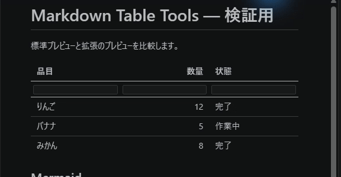
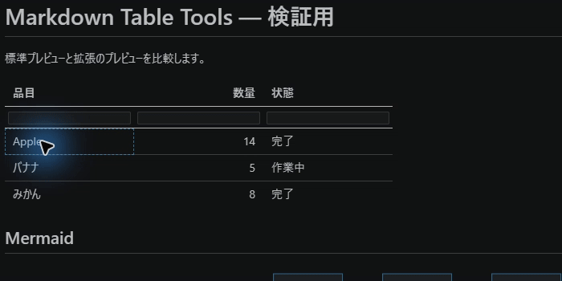
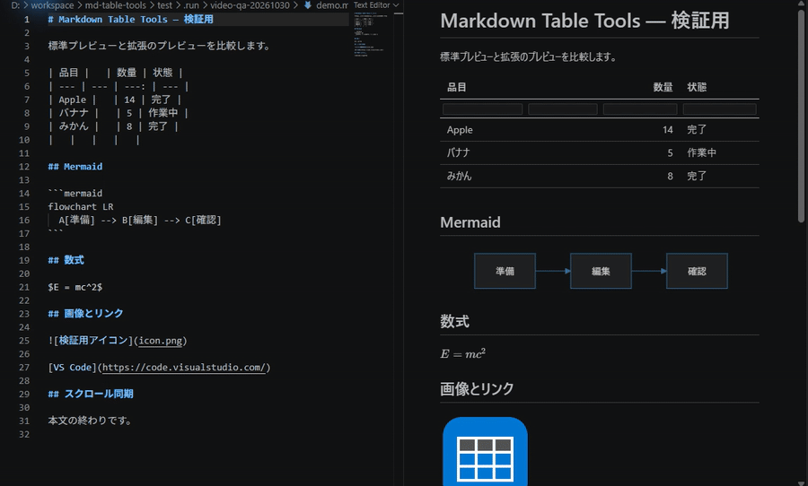

# Markdown Table Tools

Markdownファイルを全画面プレビューしながら、表を直接編集できる拡張機能です。

## インストール

- **VS Code**: Marketplace から「Markdown Table Tools」を検索してインストール
- **Windsurf / Devin Desktop 等**: Open VSX からインストール

vsix から手動導入する場合は `npm install && npm run package` で生成し、
「Install from VSIX」を実行してください。

## 使い方

Markdownファイルを開いた状態で `Ctrl+Alt+V`（Mac: `Cmd+Alt+V`）を押すか、
コマンドパレットから「テーブルプレビューを開く」を実行します。

## 機能

- **セルの直接編集**: プレビュー内の表のセルをクリックして編集
  - `Enter` で確定、`Esc` でキャンセル、`Shift+Enter` でセル内改行（` ` として保存）
  - `Tab` / `Shift+Tab` で確定しつつ隣接セルの編集へ
- **キーボード移動**: セル選択状態で矢印キー移動、`Enter`で編集開始
- **取り消し/やり直し**: `Ctrl+Z` / `Ctrl+Shift+Z`（`Ctrl+Y`）で表編集を巻き戻し
- **行・列の追加/削除**: 表を右クリックしてコンテキストメニューから操作
- **ソート**: ヘッダークリックで昇順/降順を切り替え
- **列フィルタ**: ヘッダー下の入力欄で絞り込み（表示のみ、ソースは変更しません）
- **自動保存**: 編集は既定で自動保存されます
- **標準プレビュー相当の表示**: Mermaid・数式(KaTeX)・相対画像・リンクをサポート
- **スクロール同期**: エディタとプレビューが双方向に追従します

列を追加・削除すると、別の列に条件が適用されないよう、ソートとフィルタは解除されます。

### ソート・フィルタ・行列操作

### Mermaid・数式・画像とスクロール同期

## 設定

| 設定 | 既定 | 説明 |
|---|---|---|
| `mdTableTools.autoSave` | `true` | 表の編集を自動保存する |
| `mdTableTools.openIn` | `"active"` | `"beside"` で横並び表示に変更 |

スクロール同期は標準プレビューと同じ設定（`markdown.preview.scrollEditorWithPreview` /
`markdown.preview.scrollPreviewWithEditor`）に従います。

## 動作環境

VS Code 系IDE（VS Code / Windsurf / Devin Desktop 等）を想定しています。
Mermaid・数式・標準スタイルはIDE同梱のMarkdown関連拡張の資産を再利用するため、
それらが同梱されていない環境では簡易表示になります。

## 開発・検証

`npm test` で単体テスト、`npm run test:integration` で VS Code の Extension Host テスト、`npm run test:e2e` で実 VS Code の画面操作テストを実行できます。
配布用 VSIX の確認方法と実画面の検証範囲は [検証記録](docs/verification.md) を参照してください。

## リリース（メンテナー向け）

利用者の承認後、バージョンと変更履歴を更新し、対応するタグを push します。GitHub Actions はテストと VSIX 検証の後に両ストアへ公開し、GitHub Release を作成します。必要なシークレットと失敗時の対応は[公開手順](https://github.com/hrk-ymkw/md-table-tools/blob/main/docs/release.md)を参照してください。

## ライセンス

MIT
